<a href="https://lefteros.com/en/"></a>

  
  
  
  
  
  

## Hi, I'm Lefteris, or just Lef

A friend installed **Red Hat** on my PC in 1997 and I never stopped tinkering. By day I keep companies' servers and ERP running; the rest of the time I build things with whatever is new. Lately that means AI that runs on your own machine, firmware for e-ink readers, plugins for [Omarchy](https://omarchy.org) and patches for other people's projects. On forums and almost everywhere else I'm **SomniusX**.

Everything I make, write and have worked on lives at **[lefteros_ · lefteros.com](https://lefteros.com/en/)**: the [projects](https://lefteros.com/en/apps/), the [guides and posts](https://lefteros.com/en/blog/), [the full story](https://lefteros.com/en/about/) and [where else I show up](https://lefteros.com/en/presence/). This page is the short version.

## Latest project: CrossInk, from Greek to Burmese

<a href="https://lefteros.com/en/apps/crossink-indic/">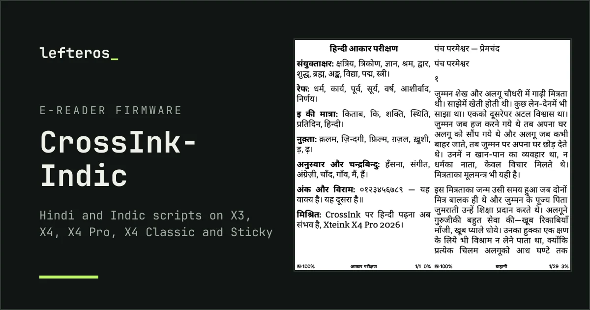</a>

**CrossInk** is open firmware (MIT) for the small **Xteink** e-ink readers. It couldn't show Greek or any Indic script: those books came out as ◆ boxes. So I added them, Greek first and then fourteen more.

**CrossInk-Indic** builds 13 Indic languages and Burmese right into the firmware, each with its fonts, its shaping and its own menu: Hindi, Marathi, Nepali, Bengali, Assamese, Punjabi, Gujarati, Odia, Tamil, Telugu, Kannada, Malayalam, Sinhala and Burmese. No fonts on an SD card needed. It runs on every Xteink, the X3, X4, X4 Pro, X4 Classic and Sticky, and the Burmese build is already on a reader's X4 Pro in Myanmar.

**[CrossInk-Indic on lefteros.com →](https://lefteros.com/en/apps/crossink-indic/)** · [Download v1.6.0-indic.4](https://github.com/Somnius/CrossInk-Indic/releases) · [Hindi](https://lefteros.com/en/blog/crossink-indic/) · [13 languages](https://lefteros.com/en/blog/crossink-indic-13-languages/) · [Burmese](https://lefteros.com/en/blog/crossink-burmese/) · pre-release

### CrossInk in Greek

I built Greek support in under 24 hours, and it's out as a test build for the **Xteink X4 Pro**.

- **Greek in the reading fonts.** Bitter and Lexend Deca have no Greek, so Greek subsets of Noto Serif and Noto Sans now sit next to them in every style.
- **Greek hyphenation.** With justified text, words break where they should: κα-λη-μέ-ρα, ηλε-κτρο-νι-κός, προ-ϋ-πό-θε-ση.
- **A Greek menu.** All 843 interface strings are translated.
- **Greek titles everywhere.** The home screen, descriptions and clippings show Greek titles and authors properly, even with an English menu.
- **Room to spare.** With Vietnamese and Arabic taken out, the Greek build is still about 57 KB smaller than the official 1.6.0.

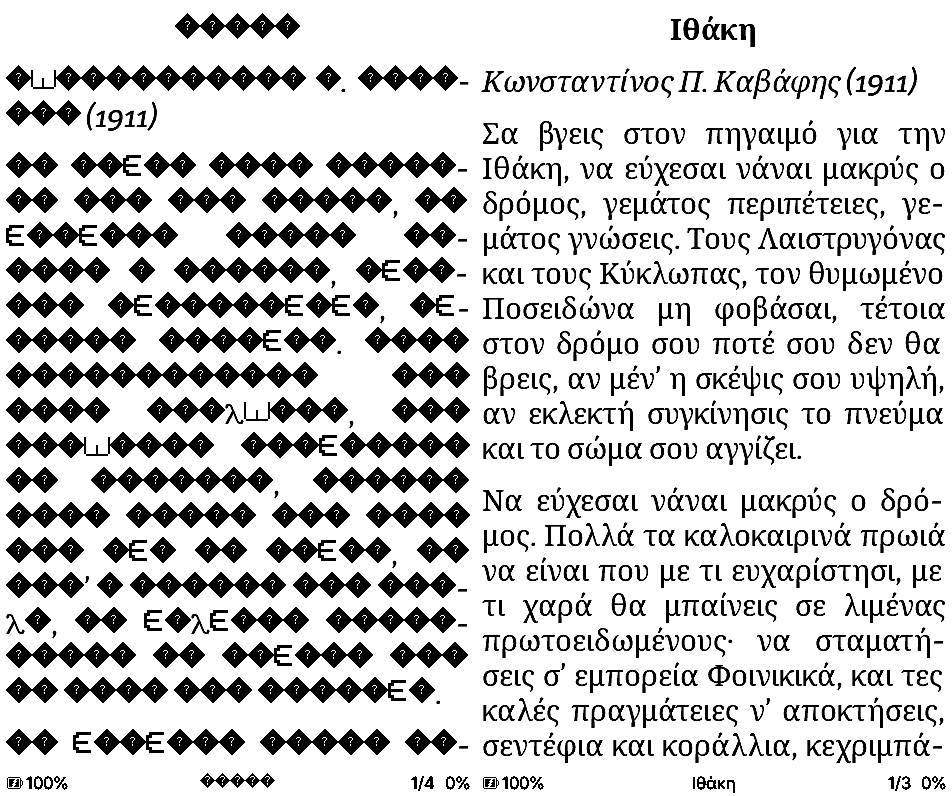 
Cavafy's <i>Ithaka</i> in Bitter: on the left the official 1.6.0, on the right the Greek build.

**[The app page on lefteros.com →](https://lefteros.com/en/apps/crossink-greek/)** · **[How it was built, step by step →](https://lefteros.com/en/blog/crossink-greek/)**
 [Download v1.6.0-greek2 for the X4 Pro](https://github.com/Somnius/CrossInk/releases) · [The proposal to CrossInk (#789)](https://github.com/uxjulia/CrossInk/discussions/789) · beta

## Languages and tools

   
  

Also: Proxmox · ESXi · KVM · MikroTik · Synology · Microsoft 365 · MS SQL · Semantic · Cubit · Soft1 · Singular / Epsilon · whisper.cpp · llama.cpp · Ollama · ChromaDB · MCP

## Flagship: ShadowRealms AI

<a href="https://lefteros.com/en/apps/shadowrealms-ai/">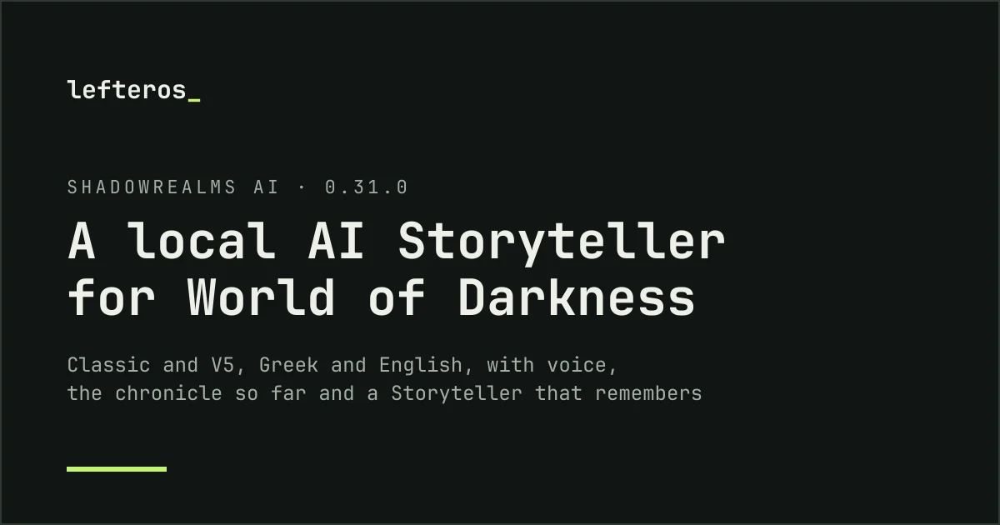</a>

**[ShadowRealms AI](https://github.com/Somnius/shadowrealms-ai)** is a self-hosted AI Storyteller for World of Darkness chronicles. You run it yourself with Docker, the stories come from local models through LM Studio and Ollama, and every chronicle plays by **Classic** (oWoD Revised: Vampire, Werewolf, Mage) or **V5** rules, in English or Greek. It's my biggest project.

<a href="https://github.com/Somnius/shadowrealms-ai/releases/download/trailer-v0.14.0/trailer_en_1080p60.mp4">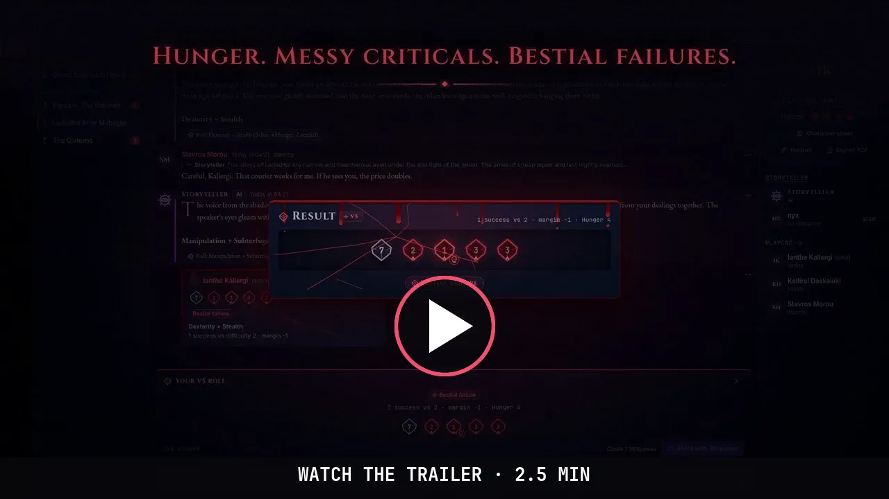</a> 
<b><a href="https://github.com/Somnius/shadowrealms-ai/releases/download/trailer-v0.14.0/trailer_en_1080p60.mp4">Trailer in English</a></b> · <b><a href="https://github.com/Somnius/shadowrealms-ai/releases/download/trailer-v0.14.0/trailer_el_1080p60.mp4">Greek version</a></b> · 2.5 minutes, the new trailer from v0.14.

- **Two rule sets.** Classic dice follow Revised (difficulties, botches, specialties, Willpower). V5 brings Hunger dice, messy criticals, bestial failures and Rouse checks.
- **Dice from your sheet.** When the Storyteller calls for a roll, the server works out the pool from your character sheet, and every dice card in the chat is a real server roll.
- **Discord-style play.** In-character and out-of-character rooms, live updates, slash commands, and a character forge for each edition.
- **AI in roles.** English and Greek Storytellers (Llama-Krikri for Greek), long-term memory and rule-book search with bge-m3 in ChromaDB, and the Laya classifier moderating the OOC rooms.
- **A gothic look.** 97 original SVG glyphs and sigils, animated dice, fog, candle glow and blood on a botch.
- **Characters by the book.** V5 characters in the corebook's order with a rules catalog from 24 books, ghoul sheets for both editions, and every sheet as a PDF.
- **Voice in the chat.** Hear the chat read aloud in English or Greek, a voice for each character and a narrator per chronicle, and speak your own lines. Piper, Pocket TTS and Whisper, all running locally.
- **The chronicle so far.** The local model writes each chronicle up as minutes, night by night, as Markdown or PDF. The Storyteller reads them before every reply, so it remembers what happened three nights ago.

<table>
<tr>
<td width="33%" valign="top"> A V5 chronicle in play</td>
<td width="33%" valign="top"> The chronicle hall</td>
<td width="33%" valign="top"> A bestial failure</td>
</tr>
<tr>
<td width="33%" valign="top"><a href="https://github.com/Somnius/shadowrealms-ai">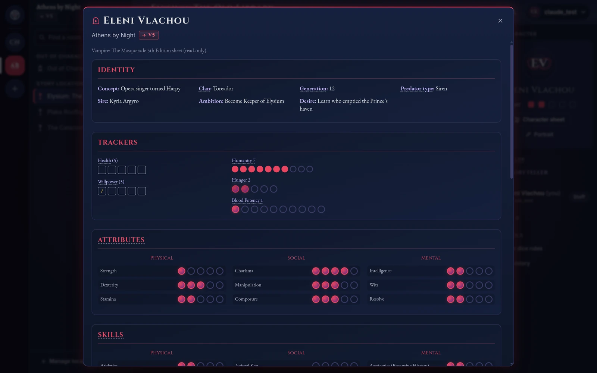</a> A V5 character sheet</td>
<td width="33%" valign="top"><a href="https://github.com/Somnius/shadowrealms-ai">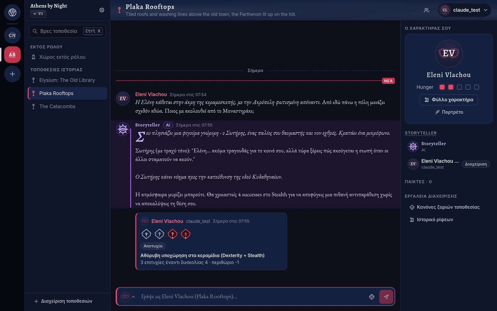</a> Playing in Greek</td>
<td width="33%" valign="top"><a href="https://github.com/Somnius/shadowrealms-ai">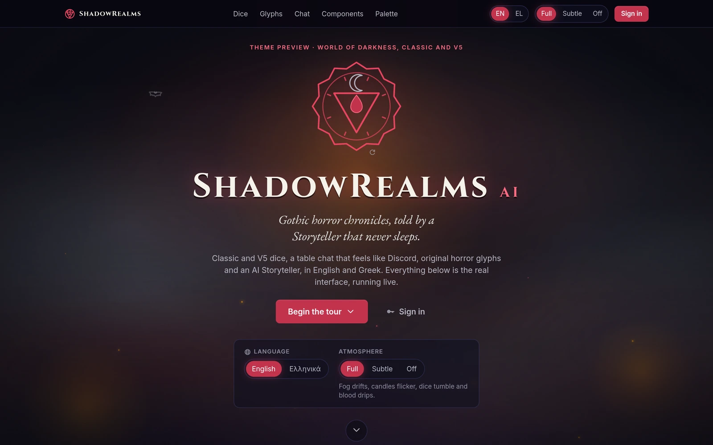</a> The theme preview</td>
</tr>
</table>

  · **[Read the story on lefteros.com →](https://lefteros.com/en/apps/shadowrealms-ai/)**

## Omarchy plugins

Omarchy is an Arch + Hyprland setup by Basecamp. I build plugins for its bar, and five of them got their tooltips back on Omarchy 4.0.4 and are ready for Qt 6.12.

<table>
<tr>
<td width="50%" valign="top">
<a href="https://lefteros.com/en/apps/omarchy-windows-vm/">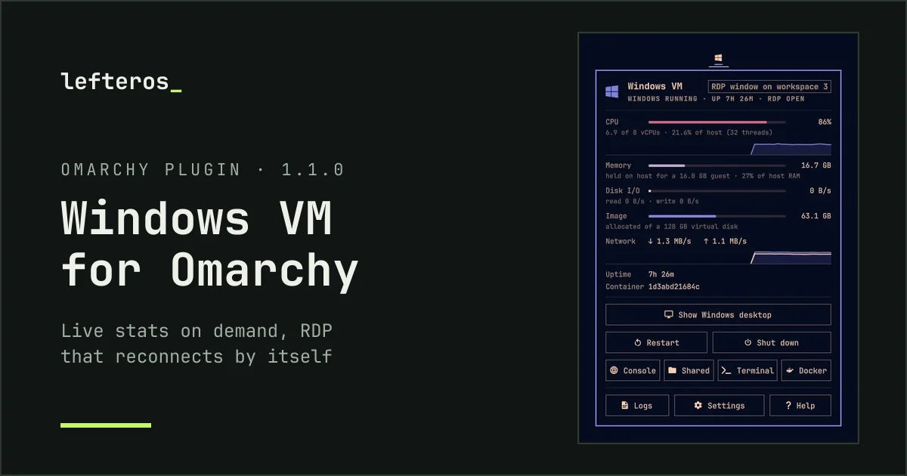</a>
<b><a href="https://github.com/Somnius/Windows-VM-for-Omarchy">Windows VM for Omarchy</a></b> 
Connect without a password prompt, RDP that reconnects by itself, live CPU, memory, disk and network graphs. 
<a href="https://lefteros.com/en/apps/omarchy-windows-vm/">On lefteros.com →</a>
</td>
<td width="50%" valign="top">
<a href="https://lefteros.com/en/apps/omarchy-keyboard-layout/">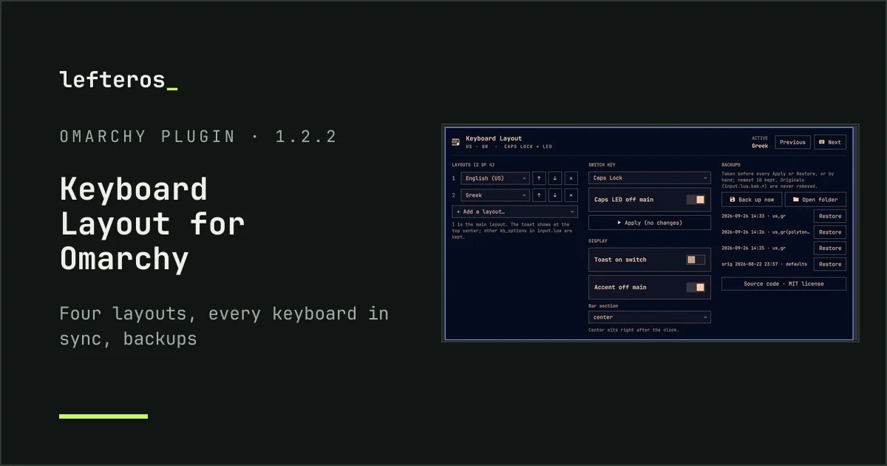</a>
<b><a href="https://github.com/Somnius/Keyboard-Layout-for-Omarchy">Keyboard Layout for Omarchy</a></b>  
A layout indicator and switcher in the bar: up to four layouts with variants, switching synced across every keyboard, safe edits of input.lua with backups. Now at 1.2.5. 
<a href="https://lefteros.com/en/apps/omarchy-keyboard-layout/">On lefteros.com →</a>
</td>
</tr>
<tr>
<td width="50%" valign="top">
<a href="https://lefteros.com/en/apps/omarchy-messaging/">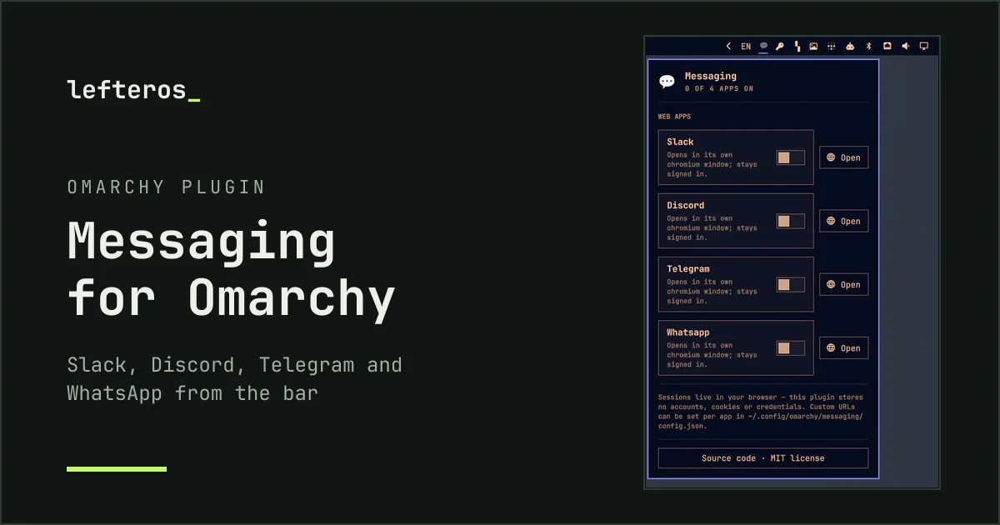</a>
<b><a href="https://github.com/Somnius/Messaging-for-Omarchy">Messaging for Omarchy</a></b> 
Slack, Discord, Telegram and WhatsApp Web in their own app windows, each with an isolated profile. 
<a href="https://lefteros.com/en/apps/omarchy-messaging/">On lefteros.com →</a>
</td>
<td width="50%" valign="top">
<a href="https://lefteros.com/en/apps/omarchy-password-store/">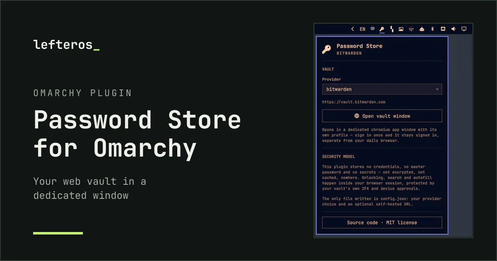</a>
<b><a href="https://github.com/Somnius/Password-Store-for-Omarchy">Password Store for Omarchy</a></b> 
Your Bitwarden, Vaultwarden, 1Password or LastPass vault in a dedicated window. It stores no credentials. 
<a href="https://lefteros.com/en/apps/omarchy-password-store/">On lefteros.com →</a>
</td>
</tr>
<tr>
<td width="50%" valign="top">
<a href="https://lefteros.com/en/apps/omarchy-wallpaper-rotate/">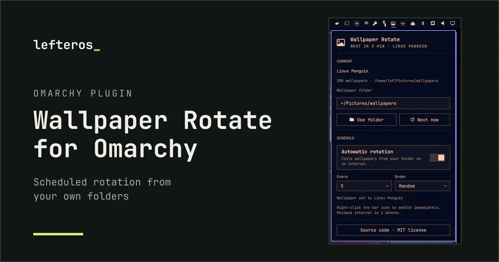</a>
<b><a href="https://github.com/Somnius/Omarchy-Wallpaper-Rotate">Wallpaper Rotate</a></b> 
Rotate wallpapers from your own folders on a schedule, with a bar icon and a click panel. 
<a href="https://lefteros.com/en/apps/omarchy-wallpaper-rotate/">On lefteros.com →</a>
</td>
<td width="50%" valign="top">
<a href="https://github.com/Somnius/serpantinum-omarchy">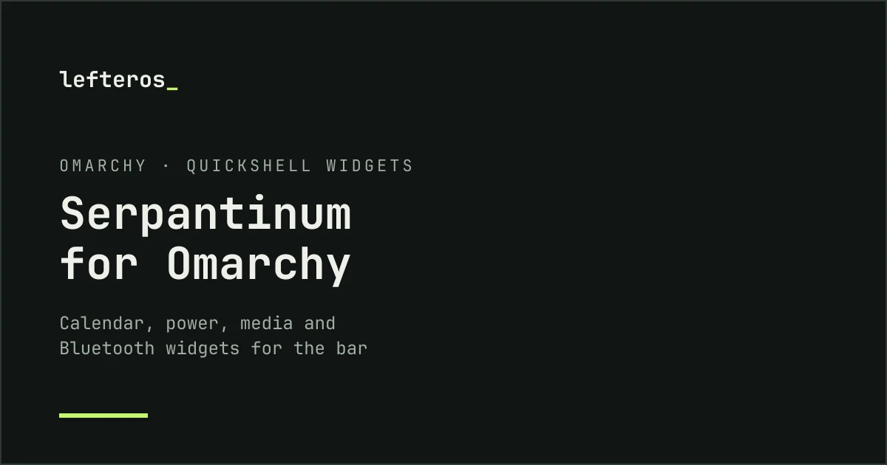</a>
<b><a href="https://github.com/Somnius/serpantinum-omarchy">Serpantinum for Omarchy</a></b>  
The Serpantinum shell's widgets brought to Omarchy: <a href="https://github.com/Somnius/serpantinum-omarchy-calendar">calendar</a>, <a href="https://github.com/Somnius/serpantinum-omarchy-power">power</a>, <a href="https://github.com/Somnius/serpantinum-omarchy-media">media</a> and <a href="https://github.com/Somnius/serpantinum-omarchy-bluetooth">Bluetooth</a>.
</td>
</tr>
</table>

## Patches upstream

When a project I use is missing something, I send the fix to the people who make it.

- **[dwm-titus](https://github.com/ChrisTitusTech/dwm-titus)**, Chris Titus's Fedora desktop: kitty that follows the theme, hidden Wi-Fi from the panel, a keyboard layout pill, seconds in the clock, clearer update docs, and skills for terminal assistants in titus-ai. [Where each one stands →](https://lefteros.com/en/apps/dwm-titus/)
- **[nema](https://git.thanosapollo.org/nema/about/)**, Thanos Apollo's XMPP messenger for Android: day separators, room names, thread markers and more, sent the old way, by email. [More →](https://lefteros.com/en/apps/nema/)
- **[eucWatch](https://github.com/enaon/eucWatch)**, an electric unicycle dash for cheap smartwatches: three fixes that sat in a fork, all merged the same evening. [More →](https://lefteros.com/en/apps/eucwatch/)
- **[Emojis & Nerd Fonts for Omarchy](https://github.com/farangkao/omarchy-emojis-nerd)**: a Recents tab, Alt+number hotkeys and hints, out in 1.2.1.
- **[Omarchy](https://github.com/basecamp/omarchy/pull/4230)**: a pull request for Libreboot / Coreboot support.

## Tools and local AI

<table>
<tr>
<td width="50%" valign="top">
<a href="https://lefteros.com/en/apps/recmeets-laya/">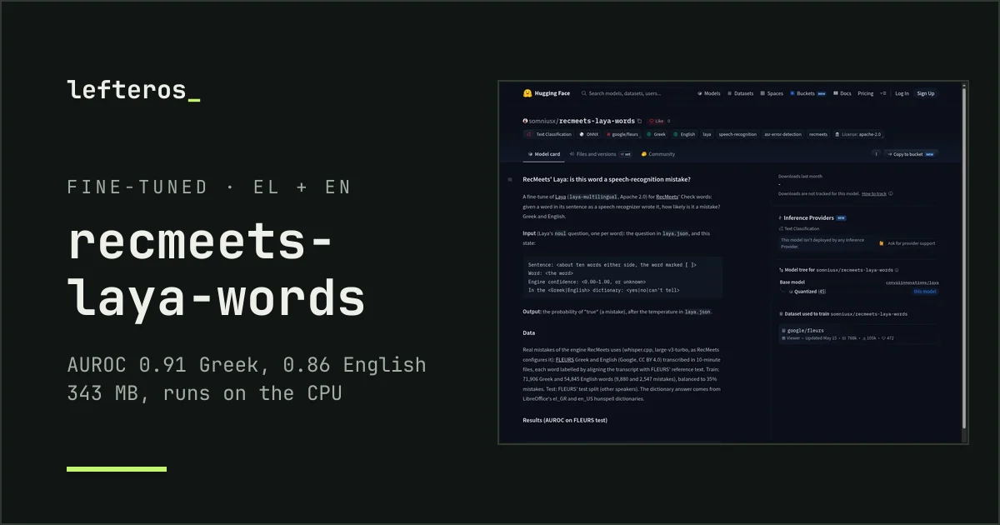</a>
<b><a href="https://huggingface.co/somniusx/recmeets-laya-words">RecMeets' Laya</a></b> 
A model of my own on Hugging Face. It finds the words a speech recognizer got wrong, in Greek and English, and runs on the processor: ONNX, 343 MB, AUROC 0.91 in Greek, Apache 2.0. 
<a href="https://lefteros.com/en/apps/recmeets-laya/">On lefteros.com →</a>
</td>
<td width="50%" valign="top">
<a href="https://lefteros.com/en/apps/recmeets/">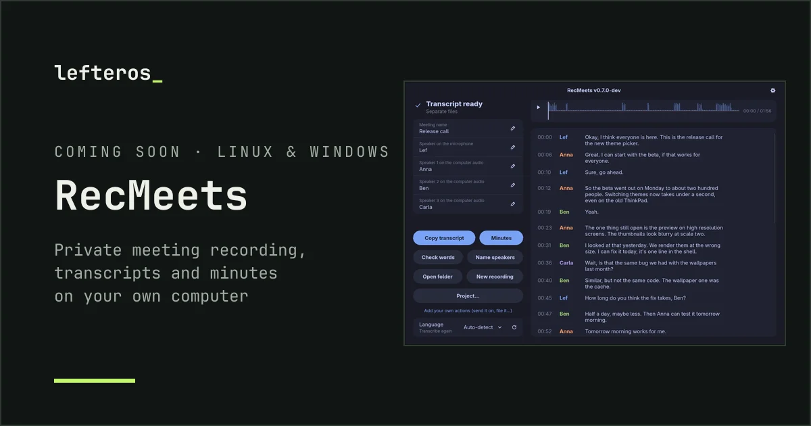</a>
<b><a href="https://lefteros.com/en/apps/recmeets/">RecMeets</a></b> · <i>coming soon</i> 
Two-track meeting recording with local transcription, speakers and chapters. Rust, whisper.cpp, ONNX Runtime. 
<a href="https://lefteros.com/en/apps/recmeets/">On lefteros.com →</a>
</td>
</tr>
<tr>
<td width="50%" valign="top">
<a href="https://github.com/Somnius/virt-spinner">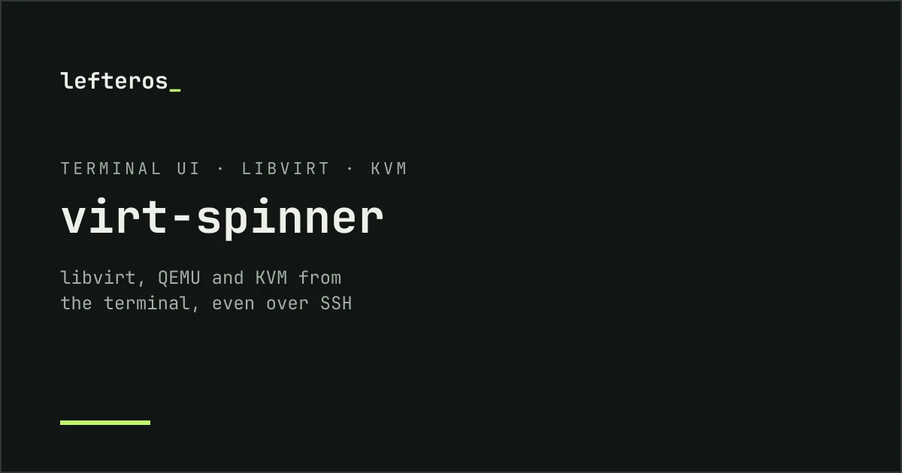</a>
<b><a href="https://github.com/Somnius/virt-spinner">virt-spinner</a></b>  
A keyboard-driven TUI for libvirt, QEMU and KVM, a lighter alternative to GNOME Boxes and virt-manager that works over SSH.
</td>
<td width="50%" valign="top">
<a href="https://github.com/Somnius/VoxTyper">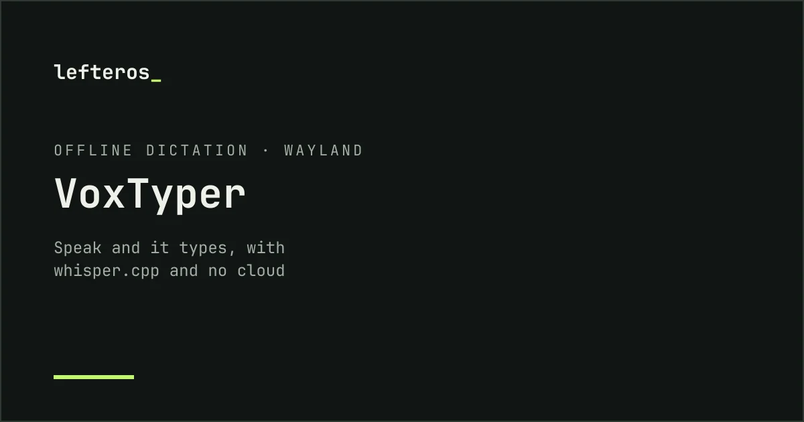</a>
<b><a href="https://github.com/Somnius/VoxTyper">VoxTyper</a></b>  
Offline dictation for Arch + Hyprland and Fedora KDE on Wayland, built on whisper.cpp. 
<a href="https://lefteros.com/blog/linux-user-6142/">The guide on lefteros.com (Greek) →</a>
</td>
</tr>
<tr>
<td width="50%" valign="top">
<a href="https://lefteros.com/en/apps/sticky-board-export/">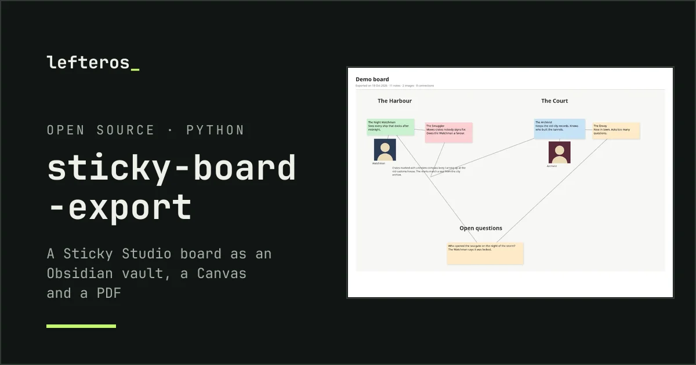</a>
<b><a href="https://github.com/Somnius/sticky-board-export">sticky-board-export</a></b> 
Exports a whole Sticky Studio board to an Obsidian vault, an Obsidian Canvas and a PDF. Python with no dependencies, and it reads only a saved copy, never the board itself. 
<a href="https://lefteros.com/en/apps/sticky-board-export/">On lefteros.com →</a>
</td>
<td width="50%" valign="top">
<a href="https://github.com/Somnius/EucWorldPebble">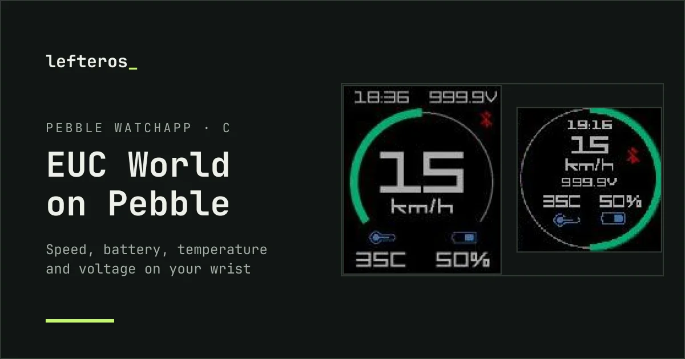</a>
<b><a href="https://github.com/Somnius/EucWorldPebble">EucWorldPebble</a></b>  
Your electric unicycle's speed, battery, temperature, voltage and current on a Pebble, round ones included. I built it with Alex Kintis on top of WheelLogPebble. 
<a href="https://github.com/Somnius/EucWorldPebble/releases">Download the .pbw →</a>
</td>
</tr>
<tr>
<td width="50%" valign="top">
<a href="https://github.com/Somnius/Claudius-Bootstrapper">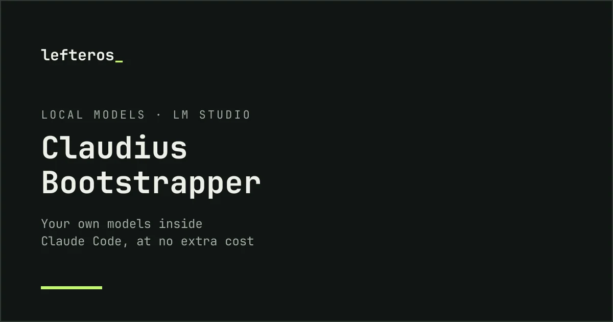</a>
<b><a href="https://github.com/Somnius/Claudius-Bootstrapper">Claudius-Bootstrapper</a></b>  
Run your own LM Studio models (or any compatible endpoint) inside Claude Code, in the terminal or in a VS Code fork.
</td>
<td width="50%" valign="top">
<a href="https://github.com/Somnius/local-mobile-llm-mcp">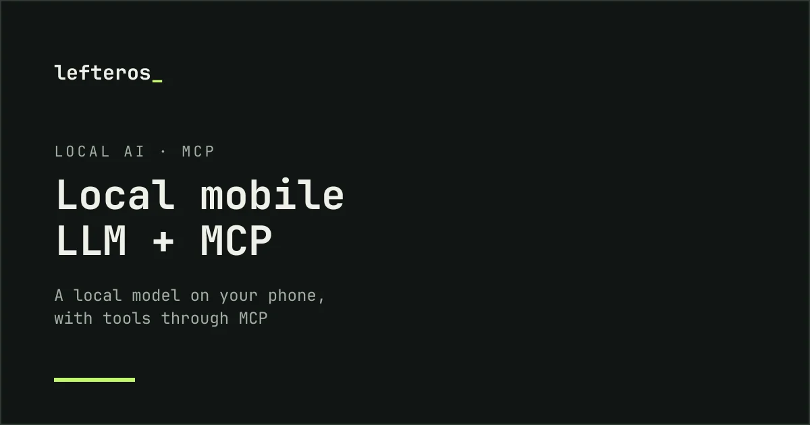</a>
<b><a href="https://github.com/Somnius/local-mobile-llm-mcp">local-mobile-llm-mcp</a></b> 
On-device LLMs for phones with MCP tools (search, files, databases), so you don't need a cloud service.
</td>
</tr>
</table>

<b>More public repos from over the years</b>

 

| Repo | What it does |
|---|---|
| [MiFlash-for-Mac](https://github.com/Somnius/MiFlash-for-Mac) | Flash Xiaomi phones from a Mac, still my most-starred repo ([on lefteros.com](https://lefteros.com/en/apps/moto-x-miflash/)) |
| [ngrok-http-1234](https://github.com/Somnius/ngrok-http-1234) | An ngrok tunnel to a local model server, with editor settings updated automatically |
| [tg-mail-mini-app](https://github.com/Somnius/tg-mail-mini-app) | A full email client as a Telegram mini app |
| [send-html-javascript-to-telegram-bot](https://github.com/Somnius/send-html-javascript-to-telegram-bot) | Send a web form to a Telegram group through the Bot API |
| [MacHosts](https://github.com/Somnius/MacHosts) | A big hosts file for macOS instead of ad blockers |
| [Kreep-Out](https://github.com/Somnius/Kreep-Out) | Keep what creeps you out away from your Mac |
| [Moto-X-2014-Flash](https://github.com/Somnius/Moto-X-2014-Flash) · [Warning Boot Logo Remover](https://github.com/Somnius/Moto-X-2014-Warning-Boot-Logo-Remover) | Moto X 2014 flashing tools ([on lefteros.com](https://lefteros.com/en/apps/moto-x-miflash/)) |
| [XH_Home_for_TV](https://github.com/Somnius/XH_Home_for_TV) | A Greek build of the Xiaomi TV box launcher |
| [kde-plasma-6-backup](https://github.com/Somnius/kde-plasma-6-backup) | Back up and restore a KDE Plasma 6 desktop |

> **There's more behind the curtain.** Many of my repos are private: personal projects, client work and business tools (ERP bridges, retail data pipelines, infrastructure scripts). The public ones are the tip. [lefteros.com](https://lefteros.com/en/apps/) tells the rest.

## What I do

<table>
<tr>
<td width="50%" valign="top"><b>ERP and business systems</b> Twenty years on retail, logistics and commercial ERP: Semantic, Cubit, Singular / Epsilon, Soft1. I centralise the data and build the bridges and reports that keep it honest.</td>
<td width="50%" valign="top"><b>Infrastructure and servers</b> Windows and Linux servers, Proxmox, ESXi and KVM, NAS, Microsoft 365, backups and disaster recovery. I've moved offices to the cloud, and they stayed up.</td>
</tr>
<tr>
<td valign="top"><b>Linux, down to the firmware</b> From Red Hat in 1997 to <a href="https://lefteros.com/blog/linux-user-6006/">Libreboot on ThinkPads</a>, <a href="https://lefteros.com/blog/linux-user-6339/">declarative NixOS</a> and tools for Omarchy.</td>
<td valign="top"><b>Local AI and speech</b> Models that run on your own machine: an AI Storyteller for World of Darkness with RAG memory, meeting transcription without the cloud, offline dictation, and <a href="https://lefteros.com/en/apps/recmeets-laya/">a model of my own on Hugging Face</a> that finds misheard words.</td>
</tr>
<tr>
<td valign="top"><b>Servers under pressure</b> With the RFS Dev Team I kept an event with <a href="https://lefteros.com/en/blog/gameathlon-athens-2013/">8,000+ simultaneous players</a> online.</td>
<td valign="top"><b>Languages on every screen</b> 37,200+ changes to <a href="https://lefteros.com/en/apps/miui-v5-greek-translation/">the MIUI Greek translation</a>, OnePlus texts, Call Recorder, tTorrent, Mac localisations, and now e-ink readers in <a href="https://lefteros.com/en/apps/crossink-greek/">Greek</a>, <a href="https://lefteros.com/en/apps/crossink-indic/">13 Indic languages and Burmese</a>.</td>
</tr>
</table>

## Fun facts

- A friend showed me **Red Hat in 1997**. A month later I installed it myself, partitions and all, and never went back.
- During a mass-login event our Minecraft server hit **8,000+ players at once**. It held on two Xeons, **64 GB of RAM used as a disk**, and a lot of nerve. I told the story at HAEC.
- My **first standalone WinBox for Mac** earned me a **Level 5 licence from MikroTik**.
- A 1:10 map of **Ancient Greece in Minecraft** that we built [made the SKAI evening news](https://lefteros.com/en/blog/ancient-greece-minecraft-map-skai-2016/) in 2016.
- I moderated Hackintosh forums for years and ran [HellasProject](https://lefteros.com/en/presence/) from 2007 to 2014.
- These days I flash **Libreboot onto ThinkPads** for fun, and I called the first **Omarchy Greece** meetup.
- Away from the screen it's music first: I hold a **piano diploma** from the Greek National Conservatory, play guitar and record my own samples. The house is slowly turning smart on Raspberry Pi and Arduino boards, and I still ride electric unicycles.

<b>Twenty-seven years, in one scroll</b>

 

| When | What |
|---|---|
| **2025 → now** | EDP, IT, ICT and project manager · ShadowRealms AI · CrossInk in Greek and CrossInk-Indic · RecMeets and its Laya model · patches for dwm-titus, nema and eucWatch · Libreboot, NixOS and Omarchy |
| **2023 – 2025** | IT manager and ERP consultant, MPALASKAS YSS SA |
| **2023** | DevOps, SaaS / PaaS, EDP / TSG, CoreiT Greece |
| **2019 – 2023** | IT manager and ERP consultant, ALEXANDROS SA |
| **2019 → now** | Guides on Linux-User.gr |
| **2013 – 2017** | Freelance years: websites, e-shops and SEO · game servers with the RFS Dev Team · Greek translations for MIUI and OnePlus · office moves to the cloud |
| **2006 – 2016** | Logistics, ERP and in-house IT |
| **2007 – 2014** | HellasProject: Mac and iPhone apps, localisations, guides |
| **1999 – 2003** | Systems, network and ISO 9001 quality, Porto Hydra |
| **Alongside** | IT and Head of IT in shipping (under NDA) · freelancer for businesses |

The long version, with links to each chapter: **[lefteros.com/en/about](https://lefteros.com/en/about/)**

## Latest on lefteros.com

<!-- POSTS:START -->
- [Crackling audio in Renoise on Omarchy: the realtime fix, without rtkit](https://lefteros.com/en/blog/omarchy-renoise-realtime-audio/) · 22 Oct 2026
- [PHP2Shell: if your site runs on WordPress, update PHP, not the plugins](https://lefteros.com/en/blog/php2shell/) · 22 Oct 2026
- [ShadowRealms AI 0.29 to 0.31: the Storyteller remembers](https://lefteros.com/en/blog/shadowrealms-ai-0-31/) · 19 Oct 2026
- [ShadowRealms AI 0.23 to 0.28: the chronicle so far](https://lefteros.com/en/blog/shadowrealms-ai-0-28/) · 18 Oct 2026
- [A whole board, out of the browser](https://lefteros.com/en/blog/sticky-board-export/) · 18 Oct 2026
<!-- POSTS:END -->

The list updates itself every day from the [lefteros.com feed](https://lefteros.com/en/rss.xml). **[All posts →](https://lefteros.com/en/blog/)**

## On GitHub

  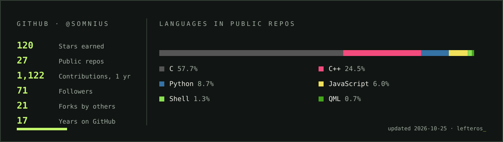

<picture>
  <source media="(prefers-color-scheme: dark)" srcset="https://raw.githubusercontent.com/Somnius/Somnius/output/snake-dark.svg">
  <source media="(prefers-color-scheme: light)" srcset="https://raw.githubusercontent.com/Somnius/Somnius/output/snake-light.svg">
  
</picture>

## Let's connect

  <a href="https://lefteros.com/en/"><b>lefteros_ · lefteros.com</b></a> ·
  <a href="https://lefteros.com/en/contact/">Contact</a> ·
  <a href="https://www.linkedin.com/in/lefteris-eliades/">LinkedIn</a> ·
  <a href="https://linux-user.gr/u/somniusx/">Linux-User.gr</a> ·
  <a href="https://lefteros.com/en/rss.xml">RSS</a>

Made in Greece, in the same style as <a href="https://lefteros.com/en/">lefteros.com</a>.

